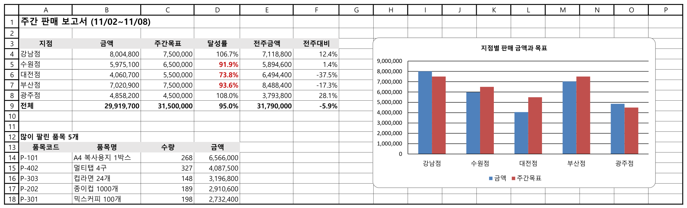

# 매주 만드는 엑셀 보고서, 파이썬으로 한 번에 (실습 자료)

지점 다섯 곳이 보낸 엑셀 파일을 합치고, 지저분한 줄을 정리하고, 검산한 뒤 서식 있는 보고서 엑셀로 내보내는 과정을 주피터 노트북 7개로 따라 합니다.

실습서 『매주 만드는 엑셀 보고서, 파이썬으로 한 번에』의 실습 파일입니다. 책이 없어도 노트북은 처음부터 끝까지 실행됩니다.

단계별 온라인 설명서: https://chanstool.com/ebook/excel-report/



위 그림은 `output/주간판매보고서_2026-11-02.xlsx`의 첫 시트입니다. 명령 한 줄로 이 파일이 나옵니다.

```
python run_report.py 2026-11-02
```

## 누구에게 맞나

- 매주 여러 사람이 보낸 엑셀 파일을 한 시트에 붙여 같은 보고서를 만드는 분
- 엑셀 피벗테이블과 VLOOKUP은 쓰지만 파이썬은 처음인 분

파이썬 문법을 처음부터 가르치는 자료는 아닙니다. 필요한 만큼만 쓰고, 각 칸이 무슨 일을 하는지 노트북에 적어 두었습니다.

## 준비물

- 윈도우 10 이상 또는 맥
- 파이썬 3.11부터 3.14까지. 노트북의 실행 결과는 3.14.7에서 만든 것입니다
- 파이썬 3.15는 아직 쓰지 마세요. 2026년 11월 15일에 윈도우의 3.15에서 설치해 보니 주피터랩이 쓰는 pyyaml 패키지의 3.15용 설치 파일이 아직 없어 `Failed building wheel for pyyaml` 오류로 멈췄습니다
- 엑셀 (결과 파일을 열어 볼 때만 필요)

## 설치

윈도우는 명령 프롬프트(cmd)에서, 맥은 터미널에서 이 폴더로 이동한 뒤 실행합니다.

윈도우 (파이썬 3.14가 없으면 먼저 `py install 3.14`)

```
py -V:3.14 -m venv .venv
.venv\Scripts\activate
pip install -r requirements.txt
jupyter lab
```

맥 (윈도우에서만 실행해 확인했습니다. 맥 명령은 파이썬 공식 문서의 방법을 따랐습니다)

```
python3.14 -m venv .venv
source .venv/bin/activate
pip install -r requirements.txt
jupyter lab
```

브라우저에 주피터랩이 열리면 왼쪽에서 `notebooks` 폴더를 열고 `01_first_read.ipynb`부터 순서대로 실행합니다. 칸을 고르고 `Shift + Enter`를 누르면 그 칸이 실행됩니다.

`requirements.txt`에는 이 노트북을 실행해 확인한 버전을 그대로 적어 두었습니다. 더 새 버전을 쓰려면 `==` 뒤 숫자를 지우고 설치하세요.

## 노트북 순서

| 노트북 | 하는 일 |
|---|---|
| `01_first_read.ipynb` | 설치 확인, 엑셀 파일 하나 읽기 |
| `02_merge_files.ipynb` | 모양이 조금씩 다른 지점 파일 다섯 개를 한 표로 합치기 |
| `03_clean.ipynb` | 빈 줄, 합계 줄, 글자로 적힌 날짜와 금액, 중복 전표 정리하고 검산하기 |
| `04_summarize.ipynb` | 지점별 합계, 목표 대비 달성률, 전주 대비, 지점×품목군 표 |
| `05_report_xlsx.ipynb` | 숫자 서식, 열 너비, 조건부 서식, 그래프가 들어간 엑셀 파일로 저장 |
| `06_one_click.ipynb` | 함수 하나와 명령 한 줄로 실행, 일부러 틀려 보고 안내 문구 확인 |
| `07_adapt_with_ai.ipynb` | 새 파일에 맞게 고치기: AI에게 보낼 글 만들기, 받은 답 검사하기 |

앞 노트북이 `work/` 폴더에 저장한 중간 결과를 뒤 노트북이 읽습니다. `work/`에 실행 결과를 넣어 두었으니 중간부터 열어도 됩니다.

## 폴더

```
data/
  raw/2026-11-02/     이번 주 지점 파일 5개
  raw/2026-10-26/     지난주 지점 파일 5개
  master/             품목 표, 지점 목표 표
  extra/              7번 노트북에서 쓰는 새 지점 파일
  make_data.py        위 파일을 다시 만드는 스크립트
notebooks/            노트북 7개 (실행 결과 포함)
work/                 노트북이 저장한 중간 결과(csv)
output/               만들어진 보고서
weekly_report.py      2~5번 노트북의 함수를 모은 파일
run_report.py         명령 한 줄로 실행
run_report.bat        윈도우에서 두 번 눌러 실행
```

## 내 회사 파일에 쓰려면

1. `data/raw/<그 주 월요일 날짜>/` 폴더를 만들고 받은 파일을 넣습니다. 파일 이름은 `지점이름_아무글자.xlsx` 모양이어야 합니다. 밑줄 앞부분을 지점 이름으로 씁니다.
2. `weekly_report.py` 맨 위의 `STANDARD`, `COLUMN_NAMES`, `SLIP_PATTERN`을 내 파일의 열 이름과 전표번호 모양에 맞게 고칩니다.
3. `data/master/`의 품목 표와 지점 목표 표를 내 것으로 바꿉니다.
4. `python run_report.py <월요일 날짜>`를 실행합니다.

열 이름이 맞지 않거나 파일이 없으면 어느 파일의 무엇이 문제인지 알려 주고 멈춥니다.

## 데이터에 대하여

`data/` 안의 회사(예제유통), 지점, 품목, 전표, 금액은 모두 `make_data.py`가 만든 가짜입니다. 실제 회사나 사람의 정보는 들어 있지 않습니다. 일부러 넣어 둔 흠은 다음과 같습니다.

| 지점 | 넣어 둔 흠 |
|---|---|
| 강남점 | 없음 |
| 수원점 | 맨 위에 제목 줄, 맨 아래에 합계 줄 |
| 대전점 | 열 이름이 다름 (일자, 코드, 상품명 등) |
| 부산점 | 날짜와 금액이 글자, 품목명 뒤 빈칸, 금액이 틀린 줄 1건 |
| 광주점 | 같은 전표가 두 번 들어간 줄 3건, 중간에 빈 줄 2개 |

## 라이선스

코드와 예제 데이터는 MIT 라이선스입니다. `LICENSE` 파일을 보세요.
